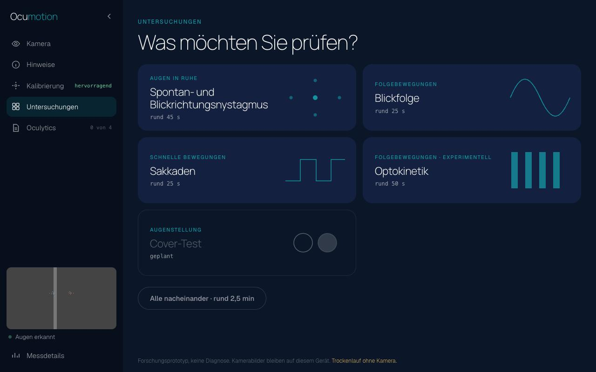
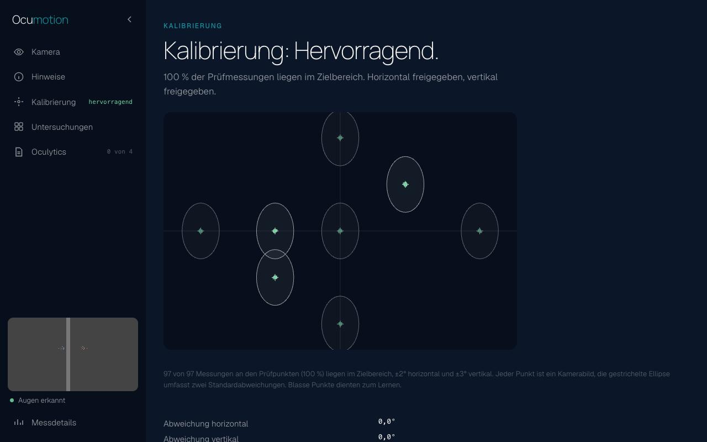

# Ocumotion

[](LICENSE)
[](CHANGELOG.md)
[](#grenzen)

> **English:** An experimental proof of concept that measures eye movements with a laptop's built-in webcam. Modules cover
> fixation, gaze holding, smooth pursuit, saccades and an experimental optokinetic test, and the Oculytics report sets the values against
> provisional working limits. Everything runs in the browser and no image leaves the device. It is not calibrated against normative data, not a medical device
> and not for diagnosis. The rest of this README is in German.

Experimenteller Proof of Concept: Ocumotion misst Augenbewegungen mit der eingebauten Laptop-Kamera, direkt im Browser. Kamerabilder verlassen das Gerät nicht und werden nicht gespeichert.

**Noch nicht mit Normkollektiven geeicht. Keine Diagnose, kein Medizinprodukt, nicht für klinische Entscheidungen.** Die Grenzen im Bericht sind vorläufige Arbeitsgrenzen.



## Start

```bash
python3 serve.py
```

Dann `http://127.0.0.1:5600` in Chrome öffnen. Es braucht Python 3 und keine Installation; Laufzeit, Modell und Schriften liegen im Repository, rund 18 MB. Geprüft ist bisher nur Chrome auf einem MacBook Pro M1.

## Was es kann

| Modul | Misst | Stand |
|---|---|---|
| Kalibrierung, optional | Maßstab aus acht Punkten, rund 20 s, mit Punktwolke | Nutzen noch nicht belegt |
| Spontan- und Blickrichtungsnystagmus | Ruckmuster in Ruhe und bei Blick zur Seite, unter Fixation | an konstruierten Signalen geprüft, nie an echtem Nystagmus |
| Blickfolge | Gain, Sakkaden je Zyklus | an einer Person gemessen |
| Sakkaden | Landegenauigkeit je Richtung | horizontal besser als vertikal |
| Optokinetik | Antwort auf bewegte Streifen | experimentell, nicht nachgewiesen |

Jedes Modul zeigt sofort eine kurze Auswertung. Oculytics fasst die Module zu einem Bericht zusammen.



Die Bilder stammen aus dem Trockenlauf mit simuliertem Gesicht. `http://127.0.0.1:5600/?trockenlauf` zeigt den Ablauf ohne Kamera.

## Grenzen

- Eine Testperson, ein Gerät, kein Vergleich mit Videookulographie und kein Patient. Die Messungen stehen in [docs/MESSUNGEN.md](docs/MESSUNGEN.md).
- 30 Bilder je Sekunde. Spitzengeschwindigkeiten und Latenzen sind damit nicht belastbar.
- Die vertikale Messung ist deutlich schwächer als die horizontale, das Lid folgt dem Blick.
- Gemessen wird immer unter Fixation. Ein Nystagmus, der sich nur ohne Fixation zeigt, bleibt unsichtbar.
- Torsion wird nicht gemessen.
- Das Gesichtsmodell stammt von Google. Google nennt als Zweck Unterhaltung mit erweiterter Realität und schließt lebenswichtige Entscheidungen aus.
- Bewertungsgrenzen stammen von diesem Aufbau und gelten woanders nicht automatisch.

## Daten

Bilder bleiben im Arbeitsspeicher des Browsers. Augenwerte werden nur gespeichert, wenn Sie es auslösen: als Datei in den Downloads oder als gemerkte Kalibrierung in diesem Browser, benannt und einzeln löschbar. Augenwerte sind personenbezogen. Die App hat keinen Server außer dem lokalen Auslieferer und ruft nichts aus dem Netz ab; `make test` prüft das.

## Mehr

| Dokument | Inhalt |
|---|---|
| [docs/PRODUKTPLAN.md](docs/PRODUKTPLAN.md) | Plan und Entscheidungen |
| [docs/KONZEPT_OCULYTICS.md](docs/KONZEPT_OCULYTICS.md) | Bericht, Einordnung, Stufen |
| [docs/KONZEPT_AUGEN.md](docs/KONZEPT_AUGEN.md) | Messprinzip |
| [docs/KONZEPT_OKULOMOTORIK.md](docs/KONZEPT_OKULOMOTORIK.md) | Kalibrierung und Untersuchungen |
| [docs/ROADMAP.md](docs/ROADMAP.md) | Backlog |
| [experimente/](experimente/README.md) | iPhone-Brücke und Nebenversuche, ungepflegt |

Fehler und Ideen bitte nach [CONTRIBUTING.md](CONTRIBUTING.md) melden, Sicherheitsfragen nach [SECURITY.md](SECURITY.md). Bitte nie Bilder oder echte Messdateien anhängen.

Ocumotion und Oculytics sind frei gewählte Projektnamen, keine eingetragenen Marken. Code und Dokumente entstanden mit KI-Unterstützung. Verantwortung und fachliche Bewertung liegen beim Autor. Zum Zitieren dient [CITATION.cff](CITATION.cff).
